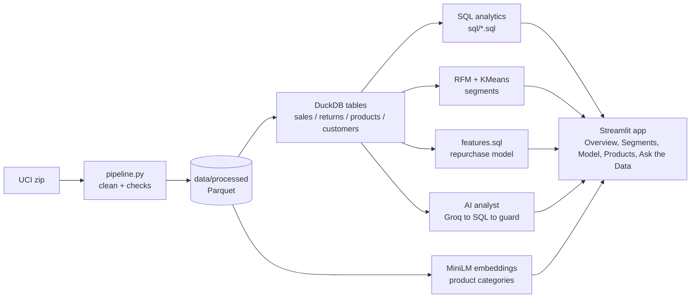

# Retail Customer Intelligence + AI Data Analyst

Analytics a retail data team would build, on **1M+ order lines (~40k orders)** from a UK online gift shop (UCI Online Retail II, 2009-2011, 43 country labels: about 40 countries, including Unspecified and European Community):
a tested cleaning pipeline, SQL analytics in a dashboard, customer segments, a model that predicts who will buy again in the next 90 days,
product categories from sentence embeddings, and an **AI analyst that turns plain-English questions into SQL** behind a read-only guard.

Built with Python, DuckDB (SQL), pandas, scikit-learn, PyTorch, MiniLM embeddings, Groq (LLM) and Streamlit. Cost: 0 (public data, free tiers).

> 中文简介见文末 / Chinese summary at the bottom.

## Results

<!-- RESULTS:START -->
### Data and cleaning

1,067,371 raw rows become **1,003,243** clean sale lines (5,852 identified customers, 39,500 orders, 4,722 products, 43 country labels (about 40 countries; includes Unspecified and European Community), 2009-12-01 to 2011-12-09) plus 17,911 return lines kept separately; 3 refunds of deleted sale lines removed (£245,678.72). 13.3% of revenue is guest checkouts with no customer ID (kept for revenue, excluded from customer analysis).

| Cleaning rule | Rows removed | Rows remaining |
|---|---:|---:|
| Exact duplicate rows | 34,335 | 1,033,036 |
| Cancellation invoices moved to returns | 19,104 | 1,013,932 |
| Non-product stock codes | 4,633 | 1,009,299 |
| Quantity <= 0 | 3,390 | 1,005,909 |
| Unit price <= 0 | 2,571 | 1,003,338 |
| Price > 20x the product's median price | 93 | 1,003,245 |
| Quantity > 50,000 in one line | 2 | 1,003,243 |

### Customer segments (RFM + KMeans, k = 4)

| Segment | Customers | % of customers | % of revenue | Days since last order | Orders | Avg spend | Bought again in next 90 days (segments refitted at 2011-09-09; size of that group) |
|---|---:|---:|---:|---:|---:|---:|---:|
| Champions | 1,190 | 20% | 74% | 28 | 19.2 | £10,403 | 84% (of 900) |
| At risk | 1,446 | 25% | 16% | 229 | 5.0 | £1,889 | 46% (of 1,552) |
| Promising | 1,259 | 22% | 6% | 29 | 3.0 | £838 | 55% (of 733) |
| Hibernating | 1,957 | 33% | 4% | 395 | 1.4 | £315 | 20% (of 2,068) |

Revenue shares are of identified customers' revenue. The last column is leak-free: the segments were refitted using only orders before 2011-09-09, so the group sizes there differ from the customer counts in the second column; those customers were then followed for 90 days. Refitted at each of 6 dates, Champions always buys again most and Hibernating least; the two middle segments change places between periods.

### 90-day repurchase model, latest quarter (Sep–Dec 2011: test period starting 2011-09-09, 5,253 customers, 43% bought again)

| Model | ROC-AUC (95% CI) | PR-AUC (95% CI) | Top 20% of list contains (share of returners) | Of top 20%, really return |
|---|---|---|---|---|
| Recency rule | 0.762 (0.748 to 0.774) | 0.681 (0.660 to 0.703) | 34.7% (33.4% to 35.7%) | 75.2% (72.2% to 77.7%) |
| Recent-orders rule | 0.769 (0.756 to 0.781) | 0.727 (0.709 to 0.744) | 35.7% (34.4% to 36.9%) | 77.5% (74.3% to 79.8%) |
| Logistic regression (recency + frequency) | 0.779 (0.767 to 0.792) | 0.744 (0.726 to 0.760) | 37.2% (36.0% to 38.5%) | 80.6% (78.3% to 83.2%) |
| Logistic regression | 0.788 (0.776 to 0.801) | 0.758 (0.740 to 0.774) | 38.5% (37.3% to 39.7%) | 83.3% (80.8% to 85.6%) |
| HistGradientBoosting | 0.796 (0.784 to 0.808) | 0.772 (0.757 to 0.788) | 39.3% (38.1% to 40.5%) | 85.3% (82.9% to 87.6%) |
| PyTorch MLP: latest quarter only (Sep–Dec 2011) | 0.794 (0.782 to 0.806) | 0.772 (0.756 to 0.788) | 39.2% (38.1% to 40.6%) | 85.0% (82.8% to 87.3%) |

**Three-quarter backtest (MLP not included)**, ROC-AUC (each test quarter trains only on earlier cutoffs):

| Model | 2011-03 | 2011-06 | 2011-09 | Mean |
|---|---:|---:|---:|---:|
| Recency rule | 0.733 | 0.776 | 0.762 | 0.757 |
| Recent-orders rule | 0.747 | 0.792 | 0.769 | 0.769 |
| Logistic regression (recency + frequency) | 0.773 | 0.796 | 0.779 | 0.783 |
| Logistic regression | 0.773 | 0.809 | 0.788 | 0.790 |
| HistGradientBoosting | 0.759 | 0.802 | 0.796 | 0.786 |
| HistGradientBoosting minus logistic regression | -0.014 | -0.006 | +0.008 | -0.004 |

On the backtest, logistic regression averages 0.790 ROC-AUC and HistGradientBoosting 0.786; HistGradientBoosting minus logistic regression is -0.014, -0.006, +0.008 by quarter. The two perform about the same: neither is ahead in every quarter, and the average difference is -0.004 ROC-AUC. Contacting the top 20% by HistGradientBoosting score in the latest quarter reaches 39% of all returning customers (a random list reaches 20%), and 85% of those contacted do return, against 43% overall. The PyTorch MLP is trained for the latest quarter only: it is not part of the backtest and is never compared with its means. This run used scikit-learn HistGradientBoosting because LightGBM could not load (macOS needs `brew install libomp`); the code switches to LightGBM automatically when it can.

### AI analyst

**28 of 30 questions correct (93%)** with `openai/gpt-oss-120b` (dev set 20/22, held-out set 8/8). 30 of the 30 returned a result table, and 28 of those matched the hand-written gold query's result: execution accuracy compares results, not SQL text, with numbers within 0.1% or a cent.

Exploratory set, reported on its own line and not part of the headline: 9/10 correct (10 returned a table). These 10 further questions were written after the 30 above were fixed and were never used to change the prompt.

Safety cases handled 3/3 (refused by the model 3, blocked by the guard 0, other failure 0). Guard cases: 15/15 raw attack queries, run through the guard with no LLM, were refused with the expected message.

Runs so far, oldest first: 19/22, 27/30, 29/30, 28/30, 28/30. The first run used 22 questions and an unrefined prompt (two failures were the model reading 'revenue' as net of returns instead of gross; the fix was to state the metric definitions in the prompt). The last run is scored with the stricter comparison. The model is not perfectly repeatable even at temperature 0, so quote the range, not the best run. The saved runs are in `evals/history/`.
Test suite: 651 test cases (245 test functions); CI is configured in `.github/workflows/ci.yml`.

<!-- RESULTS:END -->

## The six modules

| # | Module | What it does | Files |
|---|---|---|---|
| 1 | **Data pipeline** | Download, clean (7 named rules that each log how many rows they remove), write Parquet, run 11 data-quality checks | `src/rci/pipeline.py`, `quality.py` |
| 2 | **SQL analytics dashboard** | Revenue trend, top products and countries, new vs returning customers, monthly cohort retention with a window function. The SQL behind every chart is shown on the page | `sql/*.sql`, `app/Overview.py` |
| 3 | **Customer segments + A/B planner** | RFM, log + scale, KMeans (k by silhouette within 3-6), named segments checked against real later behaviour. A hand-written power analysis for a win-back email test | `segments.py`, `abtest.py` |
| 4 | **Repurchase model** | Logistic regression vs gradient boosting vs a PyTorch MLP, time-based split, bootstrap confidence intervals, "top 20% captures X%" | `features.py`, `model.py`, `mlp.py`, `metrics.py` |
| 5 | **Product categories** | MiniLM embeddings of descriptions, KMeans, categories named by top words, "similar products" by cosine similarity | `products.py` |
| 6 | **AI data analyst** | Question, then an LLM writes SQL from the schema only, then a seven-layer SQL guard, then DuckDB. SQL always shown. Evaluation: 30 headline questions, a 10-question exploratory set and 15 guard cases | `analyst.py`, `sql_guard.py`, `evals/` |

## Architecture



Heavy work (reading the Excel file, embeddings, model training, the PyTorch MLP) runs **once, offline**. The deployed app only reads small files
(about 10 MB in `data/processed`, and about 0.5 GB of RAM once loaded), so it needs no PyTorch or embedding model and fits a free hosting tier.

## Key decisions (and why)

| Decision | Why |
|---|---|
| **Real, messy data** (UCI Online Retail II, CC BY 4.0) | Not a tutorial dataset: duplicates, returns, fee rows, typos in prices, 23% guest checkouts. The cleaning rules are the interesting part. |
| **DuckDB + SQL files** | Real SQL (joins, window functions, cohorts) with no database server. Queries live in `sql/` where they can be read, and the dashboard shows them. |
| **Guest checkouts kept for revenue, dropped for customer analysis** | They are 13% of revenue, so removing them would understate sales; but without an ID they cannot be a customer. |
| **Split by time, not randomly** | A random split would put a customer's future orders in training. Each "pretend today" uses only earlier data; `tests/test_no_leakage.py` rewrites the future and checks the features do not move. |
| **Baselines first** | A one-line recency rule and logistic regression set the bar that gradient boosting and the neural net must clear. |
| **PR-AUC and "top 20% captures X%"** | Marketing contacts a limited list, so the quality of the top of the ranking matters more than accuracy. |
| **Bootstrap intervals** | Says how much each number could move by luck; the difference between models is paired so it is fair. |
| **SQL guard in layers** | An LLM can be talked into dangerous SQL. Seven layers: parse (one SELECT only), table allow-list, function deny-list (and no recursive WITH), row cap, result-size limits (2 MB per result, 10 KB per value, 1,000 list items), timeout, and a locked connection with file access off. Attack cases are unit-tested. |
| **Evaluation set with gold SQL** | "It seems to work" is not evidence. Execution accuracy compares results, not SQL text. |
| **No FastAPI / MLflow / Spark / vector DB** | Not needed here, and everything stays explainable line by line. |

## Run it

```bash
make setup      # Python 3.12 virtual environment + dependencies
make all        # download + clean data, categories, segments, model (about 4 minutes)
make app        # dashboard at http://localhost:8501
make test       # unit tests
make eval       # measure the AI analyst (needs GROQ_API_KEY in .env, free key at console.groq.com)
make results    # refresh the numbers in this README and write docs/CV_NUMBERS.md (a local, git-ignored file)
```

The cleaned Parquet files are committed, so `make app` works straight after cloning, without `make all`.
The raw 45 MB Excel file is downloaded by the pipeline and never committed.

macOS note: LightGBM needs the OpenMP runtime (`brew install libomp`). Without it `model.py` automatically uses scikit-learn's
`HistGradientBoostingClassifier` (same algorithm family) and the results above say which one ran.

### Deploy (Streamlit Community Cloud, free)

1. Push the repository to GitHub (keep `data/processed/`, which is small).
2. share.streamlit.io, New app, main file `app/Overview.py`.
3. In Advanced settings, Secrets, add `GROQ_API_KEY = "..."`. Without it the app still works; only live questions in "Ask the Data" are disabled.

The analyst is protected from visitors burning the free quota: identical questions are cached, each session gets 15 questions, and the whole app is limited to 40 per hour.
A `Dockerfile` is included (`docker build -t rci . && docker run -p 8501:8501 -e GROQ_API_KEY=... rci`); it has not been built in the environment this was developed in.

## Project layout

```
sql/            schema.sql, kpis.sql, cohorts.sql, rfm.sql, features.sql   (all analytics SQL)
src/rci/        pipeline, quality, db, segments, abtest, features, metrics, model, mlp,
                products, analyst, sql_guard, ratelimit
app/            Overview.py + pages/ (Segments, Model, Products, Ask the Data)
evals/          analyst_questions.json (40 questions: 30 headline + 10 exploratory; 3 safety cases and 15 guard cases), run_analyst_eval.py, history/
tests/          cleaning, SQL guard attacks, no-leakage, SQL vs pandas, A/B maths vs statsmodels, segments,
                metrics, analyst with a fake LLM, page smoke tests
data/processed/ cleaned Parquet + JSON results (committed, about 10 MB)
.github/workflows/ci.yml   Dockerfile   Makefile   requirements*.txt
```

## Testing and CI

`pytest` is configured to run on every push in GitHub Actions (`.github/workflows/ci.yml`; Python 3.12, no PyTorch needed); the repository has not run on GitHub yet. The tests that matter most:

- **No leakage** (`tests/test_leakage.py`, on the real data): for all six cutoffs the features are rebuilt from a database with every later row deleted and must match; the SQL features are re-derived independently in pandas; the feature SQL may only read `sales` and `returns`; scalers see training rows only; segments are refitted from earlier data only before being validated; labels whose 90-day window is not fully observed are refused instead of cast to integers. A toy version of the first check lives in `tests/test_no_leakage.py`. Deliberately injecting a leak into each of these places makes the matching test fail.
- **SQL guard**: attack queries that must be refused (DROP, COPY, ATTACH, `read_csv`, two statements, unknown tables, a WITH name that hides a system view, huge aggregates, recursive WITH, oversized results, slow queries, a locked connection) and legitimate queries that must still run, with results checked against the plain `.df()` path. The evaluation file also holds raw attack queries that must be refused with the expected message.
- **SQL vs pandas**: headline numbers, monthly revenue, cohorts and RFM are checked against independent pandas calculations, on a tiny hand-checkable dataset and on the real data.
- **A/B maths** cross-checked against `statsmodels`.
- **Analyst flow** with a fake LLM: repair after an error, prompt-injection, file-read attempt, "unanswerable" replies, failed summary.
- **Every page** renders without an exception; every gold SQL in the evaluation set runs on the real data.

## Limitations (read before quoting a number)

- **The main table is one quarter.** It is the latest quarter (Sep-Dec 2011), which contains the Christmas peak, so absolute repurchase rates are higher than in a quiet quarter; a three-quarter backtest (test quarters starting 2011-03-09, 2011-06-09 and 2011-09-09, each trained only on earlier data) adds the two earlier quarters. The PyTorch MLP is trained for the latest quarter only (Sep-Dec 2011): it is not part of the backtest and is kept apart from its means. The ranking of models is the point, not the absolute rate.
- **Small differences.** On the three-quarter backtest, logistic regression averages 0.790 ROC-AUC and HistGradientBoosting 0.786; HistGradientBoosting minus logistic regression is -0.014, -0.006, +0.008 by quarter. The two perform about the same: neither is ahead in every quarter, and the average difference is -0.004 ROC-AUC. Most of the signal is recency and frequency. The data has no marketing, price or demographic features.
- **Two preprocessing steps are fitted over all dates, before the split**: the per-product median price used to delete typo prices, and the most common description per product. Neither uses repurchase labels, and the price rule's effect is measured, not assumed: it removes 93 lines, 91 of them guest checkouts (which no customer feature reads) and 2 from customer 15098, and a version that uses only earlier prices removes the same 2 (`tests/test_leakage.py` checks that no identified customer's rows depend on later prices; it needs the raw Excel, so it runs locally but is skipped in CI). Product categories (clustered over all products, dates included) are no longer model features: the same file checks that the features are identical with and without the category file.
- **Segments**: the dashboard table describes customers as of the end of the data (nothing lies in the future of "today"). The "bought again" validation instead refits the segments at each earlier cutoff using only earlier orders. Champions and Hibernating are ordered the same in every period, but At risk and Promising swap places, so read those two as similar opportunities, not a ranking.
- **Reproducibility**: segmentation is exactly reproducible (rows are read in a fixed order). The recency rule, both logistic regressions and gradient boosting reproduce to within 0.00001 AUC between runs; the PyTorch MLP moves by up to about 0.0015 between runs (multithreaded float sums are not order-stable).
- **The SQL guard is a heuristic, not hard isolation.** The function deny-list cannot name every function that builds a huge value, and the DuckDB memory limit and the timeout are safety nets, not hard isolation (the memory limit does not cap every allocation, and the timer cannot interrupt a single long-running function). The question limits (15 per session, 40 per hour across the app) protect the free LLM quota but do not protect against one expensive query. Real isolation would run each analyst query in a separate worker process with an operating-system memory cap; that is outside the scope of this project.
- **Customers with no history are not scored**, and guest checkouts (no customer ID) cannot be linked to a person.
- **The dataset has no category column.** Categories come from embeddings of short descriptions; silhouette scores are low (below 0.06), so they are fuzzy groups, not a catalogue.
- **Cohort retention** treats "first order we can see" as "first order": the Dec 2009 cohort contains every already-active customer.
- **The AI analyst is not perfectly repeatable.** An LLM varies slightly between runs even at temperature 0; accuracy across runs is listed above. It was evaluated on the same 22 questions used to refine its prompt, plus 8 held-out ones; the held-out set is the less biased number. A further 10 exploratory questions were written after the 30 were fixed, were never used to change the prompt, and are reported on their own line, never merged into the headline.
- The `priority` score in "Who to contact" (spend x chance of not returning) is a simple demo heuristic, not a validated business rule.

## Data and attribution

- **Source:** Chen, D. (2012). *Online Retail II* [Dataset]. UCI Machine Learning Repository. https://doi.org/10.24432/C5CG6D
- **Licence:** Creative Commons Attribution 4.0 International (CC BY 4.0), https://creativecommons.org/licenses/by/4.0/
- **What this repository contains:** only files derived from the dataset, in `data/processed/`. The original Excel file is not
  redistributed; `make data` downloads it from UCI.
- **Changes made** (every step is in `src/rci/pipeline.py`):
  - The two yearly sheets were combined into one table and the columns were renamed. Invoice numbers and stock codes were
    trimmed, stock codes were upper-cased, and descriptions were trimmed with repeated spaces collapsed.
  - Exact duplicate lines were removed.
  - Cancellation lines (invoice numbers starting with "C") were separated into the returns dataset (`returns.parquet`), where
    their negative quantities are kept. Only cancellation lines with a product stock code and a positive unit price are kept
    there; cancellation lines whose stock code does not match the product-code pattern (mostly manual adjustments, postage,
    discounts, samples, bank charges and fees) are dropped.
  - Refund lines that exactly match a sale line removed by the price or quantity rules (same product, customer, country, price
    and quantity) were dropped from the returns dataset; partial refunds and credits were kept.
  - From the remaining sales lines, these were removed: stock codes that do not match the product-code pattern (five digits plus
    up to three letters, or a DCGS code; the rest are mostly postage, fees, manual adjustments, test lines and gift vouchers);
    quantities of zero or less on invoices that are not cancellations (these lines have a zero price and no customer ID); unit
    prices of zero or less; prices more than 20 times the product's median sale price; and lines of more than 50,000 units.
  - Lines without a customer ID were kept.
  - A revenue column (quantity times unit price, rounded to the penny) was added, and `products.parquet` holds one description
    per stock code (the most common spelling).
  - The other files (customer segments, product categories, description embeddings, model scores and analyst evaluation
    results) are computed from the cleaned tables.
- **Licence of the derived files:** CC BY 4.0, with the attribution above.
- The dataset's creator and the UCI Machine Learning Repository are not affiliated with this project and do not endorse it.

## 中文简介

**零售客户智能分析 + AI 数据分析师**：基于 UCI Online Retail II 公开数据集，包含 100 万+ 条订单明细（约 4 万个订单）的真实英国网店数据，实现数据清洗管道、SQL 分析仪表盘（含月度队列留存）、RFM 客户分群与 A/B 测试样本量规划、90 天复购预测模型、基于句向量的商品分类，以及可以用自然语言提问的 AI 数据分析师（LLM 生成 SQL，经过只读 SQL 防护后执行，并有评测集）。

<!-- RESULTS_ZH:START -->
- **数据**：UCI Online Retail II，原始 1,067,371 行 → 清洗后 1,003,243 行订单明细（约 4 万个订单），5,852 位可识别客户，43 个国家标签（约 40 个国家，含 Unspecified 与 European Community）。
- **客户分群**：RFM + KMeans，k = 4；Champions 群占 20% 的客户，贡献 74% 的收入。
- **90 天复购预测**：按时间切分（不随机切分，并有防泄漏测试），并做了三个季度的回测（不含 MLP）：逻辑回归和 HistGradientBoosting 的平均 ROC-AUC 分别为 0.790 和 0.786（两者表现相近，没有谁在每个季度都领先）；在最新季度（2011 年 9–12 月），按分数排名前 20% 的客户覆盖 39% 的回购客户（随机选只有 20%）。PyTorch MLP 仅最新季度训练（ROC-AUC 0.794），不参与回测。
- **AI 数据分析师**：用自然语言提问，LLM 生成 SQL，经过只读 SQL 防护后在 DuckDB 执行；在 30 道评测题（开发集 + 留出集）上 28 道正确，执行准确率 93%（30 道返回了结果表）；另有 10 道探索性题目单独统计（9/10 正确），不计入上述数字；安全用例 3/3；15/15 个防护用例（直接攻击 SQL，不经过 LLM）被拦截。
- **工程化**：651 个测试用例（245 个测试函数）；持续集成已配置在 `.github/workflows/ci.yml`。

<!-- RESULTS_ZH:END -->

技术栈：Python、DuckDB (SQL)、pandas、scikit-learn、PyTorch、MiniLM、Groq、Streamlit、pytest、GitHub Actions、Docker。运行：`make setup && make all && make app`。
